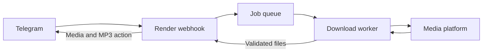

# Project map

Veltrix Downloader turns a public media link into Telegram media or an MP3. It validates the selected post, keeps carousel order and delivers photos as photos and videos as playable videos with sound, using the best compatible streams the source exposes. Long videos (up to four hours) arrive as numbered playable parts, or as files of up to 2 GB when MTProto uploads are configured.

## Where it lives

| Location | What you find there |
| --- | --- |
| [GitHub `main`](https://github.com/Rahmowin-1st/Veltrix-Downloader) | Source code, deployment config, tests and documentation |
| [@VeltrixDownloaderBot](https://t.me/VeltrixDownloaderBot) | The user-facing Telegram bot |
| [Render service](https://dashboard.render.com/web/srv-dah9pd1t0dsc73f6a20g) | Production service `veltrix-downloader`, Free plan, Frankfurt. Authorized operators can view Deploys, Logs and Environment |
| [Render host](https://veltrix-downloader.onrender.com) | Service address. Telegram calls `/telegram` with its secret header |
| `~/Veltrix-Downloader` | Suggested checkout on another computer or in Termux |

Production starts `python render_free.py` with `TERMUX_PRIMARY=0`. The Render service receives Telegram updates, downloads source media and uploads the resulting files. Termux is an optional alternative runtime.

## How a download flows

## Where to edit

| Area | Files | Responsibility |
| --- | --- | --- |
| Telegram bot | [`bot.py`](../bot.py) | Link routing, commands (`/mp3`, `/original`, `/status`), callbacks, download orchestration, progress status and Telegram delivery. Read `dispatch_job`, `run_job`, `send_album` or `grab` for the corresponding stage |
| Isolated extraction | [`download_worker.py`](../download_worker.py), [`source_metadata.py`](../source_metadata.py), [`transfer.py`](../transfer.py), [`gallery-dl.conf`](../gallery-dl.conf) | Worker result and error categories, exact-post parsing and bounded CDN transfers |
| YouTube and providers | [`vidfetch_provider.py`](../vidfetch_provider.py), [`newisty_provider.py`](../newisty_provider.py), [`youtube_public.py`](../youtube_public.py), [`cobalt_provider.py`](../cobalt_provider.py) | Provider integrations and public player fallback. `grab()` in `bot.py` defines the actual fallback order |
| Media processing | [`media_io.py`](../media_io.py), [`media_process.py`](../media_process.py) | ffprobe validation, extension repair, audio muxing, keyframe-planned splitting, CPU-aware playback preparation, thumbnails, MP3 bitrate choice and subprocess limits |
| State and upload | [`runtime_jobs.py`](../runtime_jobs.py), [`telegram_network.py`](../telegram_network.py), [`telegram_relay.py`](../telegram_relay.py), [`telegram_mtproto.py`](../telegram_mtproto.py) | SQLite queue and recovery, Telegram timeouts, optional Termux relay and optional 2 GB MTProto uploads (sent by Bot API file_id) |
| Render and secrets | [`render_free.py`](../render_free.py), [`render.yaml`](../render.yaml), [`source_auth.py`](../source_auth.py), [`.env.example`](../.env.example) | Cloud entry point, declared service, owner-authorized source sessions and config reference |
| Diagnostics | [`diagnose.py`](../diagnose.py), [`source_diagnostics.py`](../source_diagnostics.py) | Device checks and time-bounded, explicit public-source probes on Render |
| Optional Termux mode | [`termux_setup.sh`](../termux_setup.sh), [`termux_start.sh`](../termux_start.sh), [`termux_supervisor.sh`](../termux_supervisor.sh), [`termux_process.sh`](../termux_process.sh) | Phone install, start and process supervision |
| Verification | [`tests/`](../tests/), [Backend Gates](../.github/workflows/backend-gates.yml) | Unit and regression tests, dependency checks and CI on Python 3.12 and 3.13 |
| Documentation | [`README.md`](../README.md), [`CLAUDE.md`](../CLAUDE.md), [`RENDER.md`](../RENDER.md), [`docs/OPERATIONS.md`](OPERATIONS.md) | Project entry point, continuation notes and runtime guide |

## Runtime files

| Path | Contents |
| --- | --- |
| `data/jobs.sqlite3` | Default local job journal. The `DATA_DIR` setting can change its parent |
| `data/actions.json` and `data/cache/` | Default callback state and short-lived media cache |
| Temporary job directory | Source files, worker metadata and intermediate media for the active request |
| Render Logs or Termux `logs/termux.log` | Logs for the corresponding runtime |

Render Free uses a temporary filesystem. Jobs or cached files can be lost when the instance restarts. The owner manages credentials in Render Environment or a local `.env`. Keep the active Telegram receiver on one runtime per bot token.

## Version and evidence

**v10.0.0** (this branch) changes the default delivery to native photos and playable videos, adds long-video support, live progress, `/mp3`, adaptive MP3 bitrates and optional 2 GB uploads. It was verified on 23 November 2026 in a cloud container, not yet on Render:

| Check | Verified result |
| --- | --- |
| Automated suite | 283 tests passed on Python 3.13 locally; CI runs 3.12 and 3.13 |
| Instagram (live worker + real delivery preparation) | `/reel/` and `/p/` videos sent as 720×1280 fast-start H.264/AAC MP4 with width, height, duration and thumbnail; post music muxed into a silent reel |
| Snapchat (live) | Spotlight 540×960 with audio; a public story became one album of 3 videos (480×852, audio) and 1 photo (1242×2208); files now carry `.mp4`/`.jpg` instead of `.IRZXSOY` |
| Pinterest (live) | Image Pin sent as a 1000×1500 photo with its title |
| MP3 (live) | Instagram reel and Snapchat Spotlight audio delivered as MP3 with title and creator |
| Long video (synthetic, 49 MB limit) | 12 min / 210 MB → 5 playable parts of ~46 MB; 3 h / 388 MB → 9 parts totalling 10,800 s; its MP3 → 192 kbps in 6 parts |
| YouTube from a datacenter IP | yt-dlp hits YouTube's bot check; the user now gets that exact reason with no futile retry. On Render the VidFetch route serves YouTube (verified on v9.17.1) |

The previous production release is **v9.17.2**, commit [`15812ab`](https://github.com/Rahmowin-1st/Veltrix-Downloader/commit/15812ab595ed7b8b6205c0bc5016a5e1e617716c), Render deployment `dep-dc1qoi97kd5s73e9f380`. On that release the `/reel/` carousel returned all four 1440×1920 images, Pinterest videos kept audio at 576×1024 and 720×1280, a public Snapchat Spotlight downloaded at 480×880 with audio, and a `youtu.be` sample returned 1920×804 with audio via VidFetch.

Platform rows describe live source-worker probes with Telegram replaced by a recorder. Use an authorized test chat to verify the actual Telegram upload, album order, part playback and the MP3 callback after deployment.

See the [operations guide](OPERATIONS.md) for commands, limits and diagnosis. The [release audit](RELEASE_AUDIT.md) records older releases.
