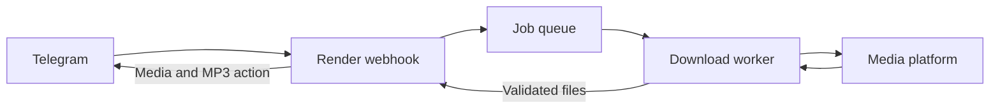

# Project map

Veltrix Downloader turns a public media link into Telegram media or an MP3. It validates the selected post, keeps carousel order and uses the best compatible streams the source exposes to the configured extractor.

## Where it lives

| Location | What you find there |
| --- | --- |
| [GitHub `main`](https://github.com/Rahmowin-1st/Veltrix-Downloader) | Source code, deployment config, tests and documentation |
| [@VeltrixDownloaderBot](https://t.me/VeltrixDownloaderBot) | The user-facing Telegram bot |
| [Render service](https://dashboard.render.com/web/srv-dah9pd1t0dsc73f6a20g) | Production service `veltrix-downloader`, Free plan, Frankfurt. Authorized operators can view Deploys, Logs and Environment |
| [Render host](https://veltrix-downloader.onrender.com) | Service address. Telegram calls `/telegram` with its secret header |
| `~/Veltrix-Downloader` | Suggested checkout on another computer or in Termux |

Production starts `python render_free.py` with `TERMUX_PRIMARY=0`. The Render service receives Telegram updates, downloads source media and uploads the resulting files. Termux is an optional alternative runtime.

## How a download flows

## Where to edit

| Area | Files | Responsibility |
| --- | --- | --- |
| Telegram bot | [`bot.py`](../bot.py) | Link routing, commands, callbacks, downloads orchestration and Telegram delivery. Read `dispatch_job`, `run_job` or `grab` for the corresponding stage |
| Isolated extraction | [`download_worker.py`](../download_worker.py), [`source_metadata.py`](../source_metadata.py), [`transfer.py`](../transfer.py), [`gallery-dl.conf`](../gallery-dl.conf) | Worker result and error categories, exact-post parsing and bounded CDN transfers |
| YouTube and providers | [`vidfetch_provider.py`](../vidfetch_provider.py), [`newisty_provider.py`](../newisty_provider.py), [`youtube_public.py`](../youtube_public.py), [`cobalt_provider.py`](../cobalt_provider.py) | Provider integrations and public player fallback. `grab()` in `bot.py` defines the actual fallback order |
| Media processing | [`media_io.py`](../media_io.py), [`media_process.py`](../media_process.py) | ffprobe validation, audio muxing, file splitting, playback preparation and subprocess limits |
| State and upload | [`runtime_jobs.py`](../runtime_jobs.py), [`telegram_network.py`](../telegram_network.py), [`telegram_relay.py`](../telegram_relay.py) | SQLite queue and recovery, Telegram timeouts and optional Termux relay |
| Render and secrets | [`render_free.py`](../render_free.py), [`render.yaml`](../render.yaml), [`source_auth.py`](../source_auth.py), [`.env.example`](../.env.example) | Cloud entry point, declared service, owner-authorized source sessions and config reference |
| Diagnostics | [`diagnose.py`](../diagnose.py), [`source_diagnostics.py`](../source_diagnostics.py) | Device checks and time-bounded, explicit public-source probes on Render |
| Optional Termux mode | [`termux_setup.sh`](../termux_setup.sh), [`termux_start.sh`](../termux_start.sh), [`termux_supervisor.sh`](../termux_supervisor.sh), [`termux_process.sh`](../termux_process.sh) | Phone install, start and process supervision |
| Verification | [`tests/`](../tests/), [Backend Gates](../.github/workflows/backend-gates.yml) | Unit and regression tests, dependency checks and CI on Python 3.12 and 3.13 |
| Documentation | [`README.md`](../README.md), [`CLAUDE.md`](../CLAUDE.md), [`RENDER.md`](../RENDER.md), [`docs/OPERATIONS.md`](OPERATIONS.md) | Project entry point, continuation notes and runtime guide |

## Runtime files

| Path | Contents |
| --- | --- |
| `data/jobs.sqlite3` | Default local job journal. The `DATA_DIR` setting can change its parent |
| `data/actions.json` and `data/cache/` | Default callback state and short-lived media cache |
| Temporary job directory | Source files, worker metadata and intermediate media for the active request |
| Render Logs or Termux `logs/termux.log` | Logs for the corresponding runtime |

Render Free uses a temporary filesystem. Jobs or cached files can be lost when the instance restarts. The owner manages credentials in Render Environment or a local `.env`. Keep the active Telegram receiver on one runtime per bot token.

## Version and evidence

Snapshot verified on **23 November 2026 (Tashkent time)**. The active code is **v9.17.2**, commit [`15812ab`](https://github.com/Rahmowin-1st/Veltrix-Downloader/commit/15812ab595ed7b8b6205c0bc5016a5e1e617716c). The Render deployment is `dep-dc1qoi97kd5s73e9f380`. Startup verified the bot identity and matching webhook, with zero pending updates at that check.

| Check | Verified result |
| --- | --- |
| Automated suite | 249 tests passed on Python 3.12 and 3.13. [Release CI](https://github.com/Rahmowin-1st/Veltrix-Downloader/actions/runs/45103384986) |
| Instagram on v9.17.2 | The `/reel/` carousel returned all four 1440×1920 images. No separate soundtrack was exposed for that post |
| Pinterest on v9.17.2 | Two videos retained audio at 576×1024 and 720×1280. A missing Pin returned `SourceUnavailable` |
| Snapchat on v9.17.2 | A public Spotlight downloaded at 480×880 with audio. An unavailable Spotlight returned `SourceUnavailable` |
| YouTube on v9.17.1 | A new `youtu.be` sample returned 1920×804 with audio via VidFetch. v9.17.2 changed Instagram, Pinterest and Snapchat handling |

Platform rows describe live source-worker probes. Delivery regressions use controlled fixtures. Use an authorized test chat to verify the actual Telegram upload, album order and inline MP3 callback.

See the [operations guide](OPERATIONS.md) for commands, limits and diagnosis. The [release audit](RELEASE_AUDIT.md) records older releases.
